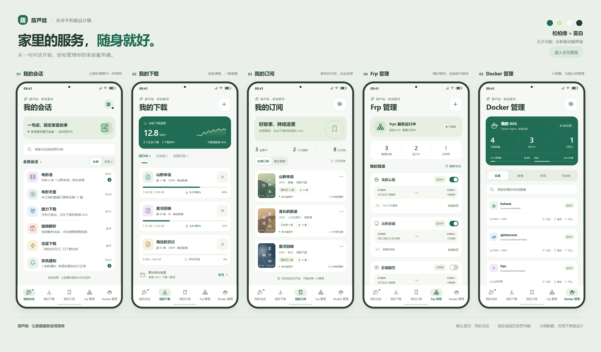

# 葫芦娃安卓客户端

独立的 Kotlin + Jetpack Compose 原生安卓工程，连接现有 huluwa 后端。界面按照已确认的松柏绿、雾白手机版设计实现，播放器使用原生 Media3。



上图是界面设计参考，不是本工程的运行截图。

## 代码已实现的功能

| 模块 | 内容 |
| --- | --- |
| 登录与连接 | 自定义服务器地址、首次初始化检测、登录、修改密码、退出及切换服务器；令牌使用 Android Keystore 加密保存，不保存登录密码 |
| 我的会话 | 默认首页、搜索与未读筛选、消息历史与分页、发送与失败重试、WebSocket 实时接收、断线重连与 REST 轮询、影视结果卡片、订阅与资源列表、原生图片及视频播放 |
| 我的下载 | 离线剧集、磁力下载、迅雷【Win】三种来源；进度、速度、状态、失败信息；HLS 取消与重试、日志、手动磁力提交、按来源清空记录 |
| 我的订阅 | 电影天堂与电影港订阅、封面及巡检信息、搜索及筛选、立即巡检、暂停与恢复、删除、资源下载及下载器设置 |
| Frp 管理 | 服务状态、隧道列表、新增、编辑、启停、删除、配置文件查看和保存、热加载、重启 frpc、容器日志 |
| Docker 管理 | 容器及用量概览、搜索、启动/停止/重启、日志与详情、停止后的删除；镜像拉取和删除、网络及存储卷创建和删除 |
| 服务设置 | qBittorrent、视频解析服务、迅雷【飞牛】、迅雷【Win】、电影港默认下载器、HLS 下载参数的原生设置表单 |

底部标签固定为：我的会话 → 我的下载 → 我的订阅 → Frp 管理 → Docker 管理。聊天详情收起底部导航，返回后回到会话列表。

## 导入工程

1. 在 Android Studio 中打开 huluwa 仓库下的 `android/` 目录，即本安卓工程根目录。
2. 使用 JDK 17 或 21，并准备 Android SDK 36。工程最低支持 Android 8.0（API 26）。
3. 后续由你选择是否同步依赖、构建和运行；本次开发没有执行这些流程。
4. 启动后填写设备可访问的 huluwa 服务地址、账号和密码。

真机应使用局域网或公网服务器地址，例如 `http://192.168.31.88:8000`。安卓模拟器访问运行在开发电脑上的后端时，可以使用 `http://10.0.2.2:8000`。手机里的 `127.0.0.1` 指向手机自身。

服务器部署在反向代理子目录时，可以填写 `https://服务器/huluwa/`。输入地址末尾多出的 `/api` 会被规范化，客户端会保留代理子目录。

## Windows 一键打包并安装 Release

在仓库根目录双击 `build-android-release.bat`，也可以在命令提示符中执行：

```bat
build-android-release.bat
```

脚本会自动查找 JDK 和 Android SDK，检查手机连接及调试授权，生成或复用 Release 签名，执行 `:app:assembleRelease`，然后安装并打开应用。单台可用设备会自动选择，多台可用设备会提示输入序号。也可以传入设备序列号，或提前设置 `ANDROID_SERIAL`：

```bat
build-android-release.bat 设备序列号
```

运行前请准备 JDK 17 或 21、Android SDK 36 和 Android SDK Platform-Tools；手机开启开发者选项及 USB 调试，用数据线连接后解锁，并允许此电脑调试。JDK 优先读取 `JAVA_HOME`，也会查找 Android Studio 自带 JDK；SDK 优先读取 `android/local.properties` 的 `sdk.dir`，其次查找 `ANDROID_HOME`、`ANDROID_SDK_ROOT`、默认安装目录及 `PATH` 中的 `adb`。首次构建需要联网下载 Gradle 和依赖。

生成的已签名 APK 位于 `android/app/build/outputs/apk/release/app-release.apk`。首次运行会生成 `android/release.keystore` 和含随机密码的 `android/keystore.properties`，以后复用同一签名；这两个文件已被 Git 忽略，请一起备份。如果已有签名，可以自行填写 `keystore.properties` 的 `storeFile`、`storePassword`、`keyAlias`、`keyPassword`；`storeFile` 相对于 `android` 目录解析。

安装使用 `adb install -r` 覆盖更新。若手机上的同包名应用使用其他签名（例如之前安装的 Debug 版），会安装失败并显示错误；请确认并备份应用数据后手动卸载旧版，再重新运行。脚本不会自动卸载应用。成功或失败后窗口都会保留，便于查看输出；命令行自动调用时可设置环境变量 `HULUWA_NO_PAUSE=1` 跳过等待按键。

## 工程配置

- 应用包名：`com.huluwa.android`
- Kotlin：`2.2.21`
- Android Gradle Plugin：`8.13.2`
- Gradle Wrapper：`8.13`，包含官方 JAR 与发行包 SHA-256 校验值
- Compose BOM：`2025.10.01`
- 界面：Material 3、Compose Foundation
- 网络：OkHttp、kotlinx.serialization
- 图片：Coil 3
- 播放器：Media3 / ExoPlayer

没有写入本机 SDK 路径、真实服务器地址、账号密码或签名密钥。

## 源码结构

```text
app/src/main/java/com/huluwa/android/
├── MainActivity.kt              应用入口
├── HuluwaApplication.kt         应用依赖
├── HuluwaViewModel.kt           页面状态、前台生命周期与操作协调
├── data/
│   ├── ApiClient.kt             API 信封、鉴权与可取消请求
│   ├── HuluwaRepository.kt      五个模块的接口与多来源聚合
│   ├── ChatRealtime.kt          实时消息、心跳与重连
│   ├── SessionStore.kt          Keystore 加密令牌
│   ├── Models.kt                数据适配、显示模型与校验
│   ├── ServerAddress.kt         地址规范化与路径编码
│   └── ImageReference.kt        镜像仓库地址与标签解析
└── ui/
    ├── HuluwaRoot.kt            原生五标签框架
    ├── Theme.kt / Components.kt 主题与共享组件
    ├── AuthScreen.kt            登录和首次初始化
    ├── SessionsScreen.kt        我的会话
    ├── ChatScreen.kt            会话详情和影视卡片
    ├── DownloadsScreen.kt       我的下载
    ├── SubscriptionsScreen.kt   我的订阅
    ├── FrpScreen.kt             Frp 管理
    ├── DockerScreen.kt          Docker 管理
    ├── AppSheets.kt / Forms.kt  原生弹层与表单
    ├── ServiceSettings.kt       各服务设置
    ├── ResourceSheets.kt        剧集资源及容器详情
    └── MediaViewer.kt           原生图片与视频预览
```

接口明细见 [接口对照](docs/接口对照.md)。

## 运行行为

下载在服务器执行，手机切到后台后服务器任务仍然继续。App 的 WebSocket 和定时刷新只在前台运行，回到前台后恢复连接与同步。

支持 HTTP 局域网服务以及 HTTPS 服务；HTTPS 使用系统证书验证。部分服务没有提供暂停、删除文件等接口时，客户端只展示服务端支持的操作。

Frp 的保存、启停和删除会按现有后端接口热加载配置。Docker 的停止、重启、删除和 Frp 的关键操作均提供原生确认弹窗。清空下载记录会明确区分记录、下载任务与已归档文件。

## 验证状态

已进行源码静态核对：接口路径与字段、Compose 依赖和图标导出、安卓资源引用、工程文件完整性。关键的地址处理、下载数据映射、镜像引用和隧道参数校验已提供单元测试源码。

**按要求未运行构建、编译、Gradle 同步、单元测试、打包或安装，未生成 APK，也未进行模拟器/真机联调。** 因此尚不能据此确认工程已通过编译或所有功能已在真实服务器上验证。
