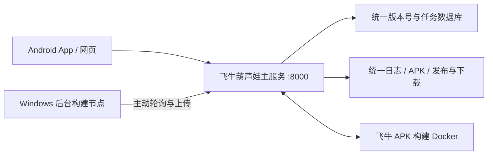

# 飞牛与 Windows 共用 APK 构建服务

部署日期：2026-10-23。

## 正式部署结构

正式主服务：`http://192.168.3.77:8000`；管理页面：`http://192.168.3.77:8000/#/android`。

飞牛保留 `huluwa-console` 和 `huluwa-android-builder` 两个容器；本机增加 `HuluwaAndroidBuilder` 后台计划任务。Windows 不再连接 `127.0.0.1:18000` 的隔离主服务，也不运行独立的正式数据库。

任务状态、日志、APK、在线升级与版本号都由飞牛主服务统一保存；切换打包服务器不改变这些公共数据。两端使用相同 Release 签名密钥，原有签名未替换。源码按同一 Git 仓库和分支更新，各自保留编译缓存。缓存无需跨操作系统复制。

## 版本号与数据同步

- 接入前飞牛最高版本是 `1.0.43 / 1043`，数据库中的计数器也是 `1043`。
- 版本代码由主服务在事务中分配，同时参考历史最高分配值；节点使用任务指定的版本编译，不能自行从本地测试版本开始计数。
- Windows 和飞牛交替构建时编号持续递增，失败和取消不回收编号。全局只执行一个活动任务，重复提交返回 409。
- 从两端状态接口获取的最新 APK、活动任务、服务器列表一致；日志与任务详情访问相同的主服务记录。
- 旧飞牛任务迁移为 `server_id=local`，原历史与 APK 路径保留。Windows 任务放在单独的 `remote-tasks/` 队列，避免 Linux worker 抢任务。
- Windows 重新注册到正式节点后使用独立任务目录，测试环境任务不会覆盖正式任务。

## 已完成验证

- 两个正式节点在线、签名就绪；Windows 与飞牛真实 Git 更新成功。
- 原 `1.0.43` APK 在升级后仍可下载，SHA-256 与历史记录一致。
- 两节点状态中的最新 APK、活动任务及部署源码快照相同。
- Windows 编译期间向飞牛节点提交第二个构建，返回 409。
- 网页 76 项测试通过、生产静态资源构建成功；合并飞牛已有界面改动后 Android 38 项单元测试通过。
- Windows worker 7 项测试通过；构建服务专项 7 项测试通过，包括 `1043 → Windows 1044 → Linux 1045` 的统一计数测试。
- 飞牛实际构建容器内运行同一组 worker 测试，6 项通过，1 项 Windows 批处理专项按平台跳过；Linux 的取消、超时、进程树清理和队列隔离均通过。
- 初次飞牛 Git 更新发现凭据脚本 CRLF 换行问题，镜像已修复并实际重试成功；Dockerfile 加入 Python 脚本换行规范化，防止从 Windows 构建时复发。

Windows 正式构建任务 `#100` 已成功：`1.0.44 / 1044`，APK 大小 3,499,063 字节，SHA-256 为 `8023905879886d7c75ee6e2fb66dee96b0e8a6ecb10b9e7c88db7301f27b30e1`。Release 编译用时 1 分 46 秒，签名校验、上传、发布和下载校验均通过。

Windows 节点停止并判定离线后，该 APK 仍可从飞牛下载；票据 HEAD、Range 206、管理员认证和节点认证检查均通过。验收结束前已重新启动 Windows 节点并确认在线。

飞牛接续构建任务 `#101` 已成功：`1.0.45 / 1045`，APK 大小 3,499,059 字节，SHA-256 为 `50b85dc7220f231bbe89060c9f89648edd703c2a75d8c58714887d1a208e04aa`。Release 编译用时 9 分 55 秒，签名校验与发布通过。

| 构建节点 | 版本 | 任务 | 结果 |
| --- | --- | --- | --- |
| 飞牛（接入前已有） | 1.0.43 / 1043 | #96 | 原产物下载校验通过 |
| Windows | 1.0.44 / 1044 | #100 | 真实 Release 构建、签名、上传、发布、下载通过 |
| 飞牛（接续验证） | 1.0.45 / 1045 | #101 | 真实 Release 构建、签名、发布、下载通过 |

两个新 APK 使用同一源码快照和原 Release 签名证书。验收结束时两个节点在线且空闲，从任意节点的状态接口均返回最新任务 `#101 / 1.0.45`；在线升级接口也返回 `1045`。两份新 APK 已从飞牛主服务下载到本机并校验大小和 SHA-256。

本机交付文件：

- `output/windows-builder-validation/huluwa-1.0.44-1044-1ebc5bd7.apk`
- `output/windows-builder-validation/huluwa-1.0.45-1045-1ebc5bd7.apk`

完整验收数据保留在受 Git 忽略且限制目录访问权限的 `data/windows-builder-production/`：`final-validation.json`、`shared-state-validation.json`、`offline-download-validation.json`。本机隔离主服务已经停止，Windows 只连接飞牛正式主服务。

## 备份与运维

更新前的数据库、源码和容器配置已备份到飞牛：

`/vol1/1000/docker/terminal-buddy/workspace/huluwa/.deploy-backups/windows-build-20261023-0845`

旧镜像保留为 `huluwa-console:pre-windows-20261023-0845` 和 `huluwa-android-builder:pre-windows-20261023-0845`。

Windows 安装目录：`C:\Users\Jing\AppData\Local\HuluwaAndroidBuilder`，计划任务为 `HuluwaAndroidBuilder`。当前用户登录后自动启动，注销期间不运行。详细安装、重启和日志命令见 [构建服务说明](../android-builder/README.md)。

## 源码与设备验收范围

本次正式构建使用包含新功能和飞牛已有界面改动的同一部署源码快照 `1ebc5bd7ec3cb20e72e9e669eda2cc5ebbec0d48`，基于 Gitee `b2d0235`。源码已同步到飞牛工作区和两个节点的构建仓库。本次功能统一提交到 Gitee `master` 分支；两个节点后续使用同一分支更新代码，持续包含多节点构建和统一版本管理功能。上述验收 APK 对应部署时的隔离源码快照，提交后的 Git 版本标识与该快照不同。

未连接 ADB 手机或模拟器，因此本次覆盖真实编译、签名校验、上传、发布和下载，不包含手机安装启动实测。最初的本机隔离测试记录见 [Windows 验收记录](windows-android-builder-validation.md)。
