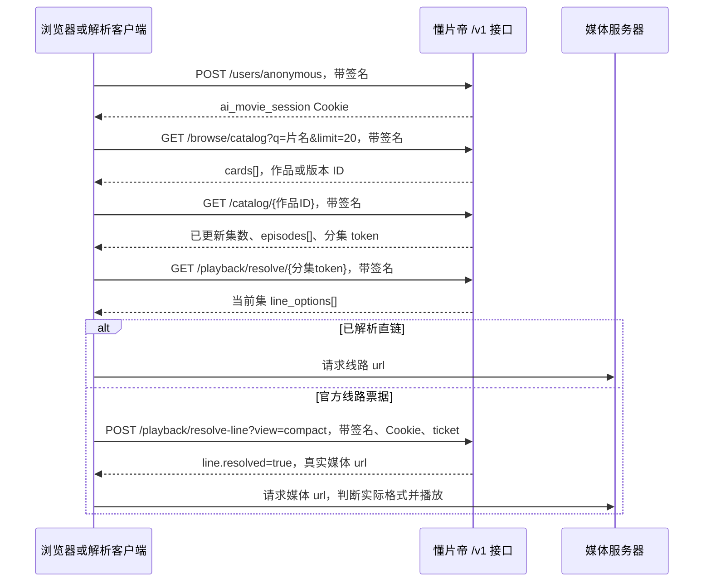

# 懂片帝网站逆向分析与排查流程

记录日期：2026-10-28。目标站点：<https://dongpian19.com/>。

本文记录从网站前端定位请求，到复现搜索、分集解析、官方线路兑换及缺源排查的具体流程，供葫芦娃安卓端和后端维护使用。项目实现说明另见 [懂片帝接入说明](懂片帝接入说明.md)。

文中的包名、压缩后的函数名、签名常量、线路覆盖范围及集数均是本次排查时的快照；站点更新后应重新从当前页面和接口取值。本文没有复现用户手机浏览器的完整播放过程；“指定 4K 源后返回其他选中源”是接口复现结果，“网页允许回退”是前端代码结论，不等于已经抓到用户那一次播放的实际媒体请求。

## 1. 整体调用流程



图中的路径均省略了 `/v1` 前缀。搜索、详情和线路清单可先读取；上图把访客初始化放在最前面，便于复现浏览器上下文。葫芦娃当前在兑换官方线路前才按需初始化访客会话。

接口签名、访客会话和媒体链接是三个不同环节：签名有效不代表已具有播放会话；获得 Cookie 不代表每一集都有所选线路；兑换出地址也不保证该地址永久可播放。

## 2. 从前端包定位协议

### 2.1 获取入口及依赖包

1. 打开网站，浏览器开发者工具进入 Network，启用 Preserve log，并关闭缓存。
2. 刷新首页，记录 HTML 中的入口脚本 `/assets/main-*.js`。
3. 打开作品播放页，触发播放器懒加载，记录新增的 JavaScript 请求。
4. 在 Sources 全局搜索下列字符串，必要时对压缩脚本进行格式化。

| 搜索字符串 | 定位目的 |
| --- | --- |
| `x-ai-movie-signature`、`HMAC` | 请求签名封装与密钥位置 |
| `/v1/users/anonymous`、`anonymous_id` | 访客初始化及 Cookie 使用方式 |
| `/v1/playback/resolve` | 单集线路查询与选源参数 |
| `/v1/playback/resolve-line` | 官方票据兑换 |
| `line_options`、`resolve_required` | 响应字段及线路类型 |
| `playback_source_id`、`provider_id`、`play_from` | 线路身份及跨集匹配 |
| `playback_resolve_ticket_expired` | 票据失效后的刷新逻辑 |

本次记录的文件及位置如下。文件名中的哈希不能作为长期固定地址。

| 文件 | 关键位置及作用 |
| --- | --- |
| `main-OEj5Tj4D.js` | 首页入口、依赖映射与路由 |
| `movie-card-runtime-C9NDS9MI.js` | `Jo` 为签名常量；`Ta()` 计算 HMAC；`Aa()` 设置签名头；访客初始化；紧凑响应字段补齐 |
| `PlayerRoute-LYP85eUS.js` | 懒加载 `player-page-Dv9RUNtD.js` |
| `global-player-host-9h-sfUqi.js` | 播放状态、线路匹配与线路运行逻辑 |
| `react-player-frame-BnNBUfqw.js` | 播放器初始化、切集、调用线路解析及媒体引擎 |
| `native-download-media-type-DE2GrYAM.js` | `Yo()` 拼线路查询参数；`Li()` 查询单集；`Ni()` 兑换；`Oe()` 选源及回退；`Ti()` 处理需解析线路 |

包名不一定反映它的全部职责。例如本次主要的播放协议位于 `native-download-media-type-*.js`，不能只凭文件名判断是否需要查看。

### 2.2 对照真实请求

在 Network 中依次执行搜索、打开资源、选集、选线路和播放，记录：

- HTTP 方法、完整路径及查询串；查询参数也是签名的一部分。
- Request Payload；特别区分网页实际发送的字段和项目为了兼容保留的字段。
- 响应状态、`object`、当前集信息、`line_options` 和实际选中的 provider。
- 是否设置、携带会话 Cookie；不把 Cookie 值放入文档或分享的日志。
- 播放器最终请求的 m3u8、MP4、分片地址，及其实际媒体信息。

只复制已签名请求长期重放会遇到时间戳、nonce 或票据失效。可复现客户端应每次重新签名。

## 3. 请求签名

### 3.1 算法

```text
message = METHOD + "\n" + pathAndQuery + "\n" + timestamp + "\n" + nonce
signature = HMAC-SHA256(secret 的 UTF-8 字节, message 的 UTF-8 字节)
```

| 项目 | 规则 |
| --- | --- |
| `METHOD` | 实际请求方法的大写形式，例如 `GET`、`POST` |
| `pathAndQuery` | `/v1/...` 开头的实际路径，含完整查询串，不含域名 |
| `timestamp` | 毫秒时间戳的十进制字符串 |
| `nonce` | 16 个随机字节转为 32 位小写十六进制字符串 |
| 签名输出 | SHA-256 HMAC 的小写十六进制结果 |

本次前端公开下发的 `Jo` 常量为：

```text
8b9a908a05eac640e1ee06f52acaa741bfe4ba9e004eeffdbeb635e532e06666
```

该值是站点前端包中的协议常量，不是用户账号凭据；它可能轮换。排查签名错误时，以当前前端包为准。

请求必须带上：

```http
x-ai-movie-timestamp: <毫秒时间戳>
x-ai-movie-nonce: <32位小写十六进制随机串>
x-ai-movie-signature: <HMAC-SHA256结果>
```

签名函数中没有拼接请求体。`POST` 请求仍需正确发送 JSON 请求体及 `Content-Type: application/json`。

### 3.2 容易出错的细节

- 路径先编码、查询串先拼完，再计算签名；发送时使用同一个字符串。
- `?view=compact`、选源参数及参数顺序都属于最终字符串的一部分；签名后不要再增删或重排参数。
- 片名及 token 按 UTF-8 做 URL 编码。网页的 `encodeURIComponent` 把空格编码为 `%20`；复现时保持一致。
- 用换行字符 `\n` 分隔四段，不是把反斜杠和字母 `n` 两个字符写入签名串。
- 重试时重新生成 timestamp、nonce 和 signature。
- `401` 可能来自签名，也可能来自会话，必须结合 `code`、`state` 和 `message` 判断。

## 4. 接口及数据流

下列站点接口均使用上述签名。表中的 `{...}` 表示本次响应下发的值，不应硬编码。

| 用途 | 方法与路径 | 主要输入或输出 |
| --- | --- | --- |
| 初始化访客 | `POST /v1/users/anonymous` | 请求 `anonymous_id`；返回会话及 Cookie |
| 搜索作品 | `GET /v1/browse/catalog?q=片名&limit=20` | 响应 `object=catalog.browse`、`cards[]` |
| 作品详情 | `GET /v1/catalog/{variantId}` | 响应 `object=catalog.detail`、分集、更新及分页信息 |
| 当前集线路 | `GET /v1/playback/resolve/{episodeToken}` | 响应 `object=playback.resolve`、当前集及 `line_options[]` |
| 分集与线路组合 | `GET /v1/playback/episodes/{episodeToken}` | 响应 `object=playback.episodes`、`episodes[]`、`episode_pagination`、当前集线路 |
| 官方线路兑换 | `POST /v1/playback/resolve-line?view=compact` | 网页请求 `{ticket}`；返回 `object=playback.line.resolve`、`line` |

成功状态通常是 `200`，访客初始化和官方兑换本次观察到 `201`。不要把 `201` 作为失败处理。

### 4.1 初始化访客会话

```http
POST /v1/users/anonymous
Content-Type: application/json
<签名头>

{"anonymous_id":"web_<UUID>"}
```

响应通过 `Set-Cookie` 设置 `ai_movie_session`。浏览器通过 credentials 机制携带 Cookie；后端复现时使用私有 Cookie 容器保存并复用。

未登录注册账号也可以拥有访客会话。出现 `playback_user_session_required` 或 `state=login_required`，需要先判断是否缺少访客 Cookie，不能直接认定必须购买会员。

同一客户端恢复会话时复用自己的 `anonymous_id`。葫芦娃当前仅在明确的会话错误后重建并重发一次；请求失败不应无限创建访客。

### 4.2 搜索作品并选择版本

```http
GET /v1/browse/catalog?q=%E5%AB%81%E9%87%91%E9%92%97&limit=20
<签名头>
```

从 `cards[]` 找到目标片名，再按以下顺序取作品版本 ID：

```text
selected_variant_id → default_variant_id → id
```

本次搜索“嫁金钗”还返回了相近片名，不能只取搜索结果第一项就用于所有关键词。实际接入应核对标题、年份及版本。

作品网页地址为：

```text
https://dongpian19.com/player/{作品版本ID}
```

### 4.3 读取详情及真实更新集数

```http
GET /v1/catalog/{作品版本ID}
<签名头>
```

关注以下字段：

| 字段 | 用途及注意事项 |
| --- | --- |
| `episodes[].number`、`title` | 定位目标集，不宜直接把数组下标当集号 |
| `episodes[].episode_track` | 区分正片和花絮；匹配正片时排除 `extras` |
| `episodes[].token` | 该集解析入口，后续请求使用 |
| `current_episode_count` | 当前更新集数 |
| `available_episode_count` | 当前可用集数 |
| `total_episode_count` | 作品总集数，可能含未来未更新集 |
| `episode_count` | 当前响应所用的集数口径，不能无条件视作已更新集数 |
| `episode_pagination` | 返回范围及是否还有后续分集 |

本次《嫁金钗》详情的真实快照为：

```json
{
  "title": "嫁金钗",
  "current_episode_count": 21,
  "available_episode_count": 21,
  "total_episode_count": 39,
  "episode_count": 40,
  "episode_pagination": {
    "offset": 0,
    "limit": 40,
    "returned_count": 40,
    "total_count": 40,
    "has_more": false
  }
}
```

该响应包含 40 个分集条目，但实际只更新到 21 集。不能根据 `episodes.length` 或 `episode_count` 把后面条目直接标成可播放。

葫芦娃当前取 `current_episode_count` 与 `available_episode_count` 中已提供值的较小者，截取作品的已更新集列表；这仍然只代表作品更新范围，不代表每一条播放源都覆盖这些集。

遇到 `has_more=true`，需要先从网页的后续分页请求确认参数，再补齐目标分集。本次样本没有触发分页，本文不假定所有详情均一次返回完整分集。

### 4.4 读取目标集线路

```http
GET /v1/playback/resolve/{目标集自己的token}
<签名头>
```

响应示意，token 和票据均为占位符：

```json
{
  "object": "playback.resolve",
  "token": "<本次响应token>",
  "current_episode": {
    "episode_number": 20,
    "sequence_index": 20,
    "display_name": "第20集"
  },
  "line_options": [
    {
      "provider_id": "bytevod-cloudflare-4k",
      "play_from": "cloudflare-4k",
      "display_label": "4K海外-官方C",
      "url": "resolve://<本集本线路票据>",
      "url_kind": "resolve_ticket",
      "resolved": false,
      "resolve_mode": "parse",
      "resolve_required": true
    }
  ]
}
```

重要字段如下：

| 字段 | 含义 |
| --- | --- |
| `id` / `playback_source_id` | 当前播放源的身份，用于精确选择；不要假设跨集不变 |
| `provider_id` + `play_from` | provider 及播放类型，网页用于匹配同类线路 |
| `source_vod_id` | 源站作品身份，是网页选源上下文的一部分 |
| `label` / `display_label` / `provider_name` | 展示名，葫芦娃当前用其匹配线路 |
| `url` | 可播放地址，或 `resolve://` 票据 |
| `resolved` | 是否已经解析出地址 |
| `resolve_required` / `resolve_mode` | 是否还需走票据兑换 |
| `url_kind` | 例如 `m3u8`、`mp4`、`resolve_ticket` |
| `selected` | 此次响应实际标为选中的源 |
| `minimum_user_level` | 线路等级要求，不等同于该集存在资源 |
| `expires_at` | 已解析地址的失效信息，字段可能缺失 |

`4K海外-官方C` 的 provider 为 `bytevod-cloudflare-4k`，普通 `海外-官方C` 为 `bytevod-cloudflare`。两者是独立源，不能通过删除名称里的 `4K` 就认定是同一个资源。

### 4.5 紧凑响应的字段补齐

网页对播放接口使用 `view=compact`。前端仅对声明 `view=compact` 的 `playback.resolve`、`playback.line.resolve` 响应执行补齐：

```text
缺少 playback_source_id 时，用 id 补齐
缺少 display_label 时，用 label 补齐
缺少 provider_name 时，用 label 补齐
```

因此复现时既要能读完整响应，也要能读紧凑响应。不能因紧凑响应没有冗余展示字段，就误判某条线路消失。

### 4.6 携带网页选源上下文

前端 `Yo()` 会把以下可用值加入 `/v1/playback/resolve/{token}` 的查询串：

| 查询参数 | 来源 |
| --- | --- |
| `line` | `selection.playback_source_id` |
| `provider_id` | `selection.provider_id` |
| `play_from` | `selection.play_from` |
| `source_vod_id` | `selection.source_vod_id` |
| `episode_index` | `billingContext.sequence_index` |
| `episode_count` | `billingContext.episode_count` |
| `content_kind` | `billingContext.content_kind` |
| `quota_debug` | 前端调试配置，常规复现不需要 |
| `view` | 播放客户端设置为 `compact` |

请求示意：

```http
GET /v1/playback/resolve/{第21集token}?provider_id=bytevod-cloudflare-4k&play_from=cloudflare-4k&view=compact
<按完整路径及查询串生成的签名头>
```

选源参数只是选择上下文，不是服务端一定提供所选线路的保证。收到响应后还要检查 `line_options` 是否真的包含目标 provider，以及 `selected=true` 的究竟是哪一条。

### 4.7 兑换官方票据

网页本次的实际请求为：

```http
POST /v1/playback/resolve-line?view=compact
Content-Type: application/json
Cookie: ai_movie_session=<当前访客会话>
<按 POST 及含查询串的路径生成的签名头>

{"ticket":"<去掉 resolve:// 前缀后的票据>"}
```

葫芦娃当前使用不带 `view=compact` 的接口，并发送：

```json
{
  "ticket": "<当前集、当前线路的票据>",
  "episode_token": "<目标集token>"
}
```

项目这种请求在前序排查中成功兑换过。`episode_token` 是当前项目发送的字段，不能据此说它是本次网页请求的必填项；网页只发送 `ticket`。必须先读取目标集的线路，再使用那一集自己的票据，不能从首集拿票据去代替后续集。

成功响应示意：

```json
{
  "object": "playback.line.resolve",
  "line": {
    "provider_id": "bytevod-cloudflare-4k",
    "label": "4K海外-官方C",
    "url_kind": "m3u8",
    "resolved": true,
    "resolve_required": false,
    "url": "https://<媒体域名>/<临时播放地址>"
  }
}
```

判断成功要接受 `200`、`201`，并检查 `line.resolved=true` 和绝对 HTTP(S) 地址。不能只检查 `.m3u8` 后缀。

网页会在明确的 `404 + code=playback_resolve_ticket_expired` 后刷新对应集、对应源的票据，再尝试兑换；刷新无效或仍过期时结束，不无限重试。葫芦娃当前没有完整复刻这一票据刷新流程。

## 5. 为什么拿到视频地址后仍要识别格式

已有排查记录显示，官方线路可能返回：

- 普通 m3u8 地址。
- MP4 地址。
- 没有常见视频扩展名的地址。
- 看起来以 `.jpg~...image.image` 结尾，但文件头为 MP4 `ftypisom` 的地址。

因此应把 `url_kind`、HTTP 响应及内容头结合起来判断。小范围读取文件头即可区分 `#EXTM3U` 和 MP4 `ftyp`；遇到主播放列表还要继续读取子播放列表。

线路名字写着“4K”也不能作为分辨率证据。实际画质应从 m3u8 的变体信息或最终视频流的宽高判断。

站点 Cookie 只交给站点接口，不向媒体域名转发。媒体是否需要额外头部，以实际媒体请求为准；本次没有证明所有线路统一要求某个 Referer。

## 6. 网页找不到指定源时的回退行为

前端 `Oe()` 的选择顺序还原如下：

```javascript
function chooseLine(lines, selection, allowFallback = false) {
  const candidates = prepareCandidates(lines);
  return candidates.find(line => matchesSelection(line, selection))
    ?? (allowFallback ? choosePreferredCandidate(candidates) : undefined)
    ?? candidates.find(line => line.selected === true)
    ?? candidates[0];
}
```

其中 `prepareCandidates` 和 `choosePreferredCandidate` 是对压缩函数职责的命名，不是原始函数名。匹配函数的规则是：

1. selection 提供了 `playback_source_id` 时，先按该身份匹配。
2. 否则，如果同时提供 `provider_id` 和 `play_from`，按这两个字段匹配。
3. 否则，如果提供了 `source_vod_id`，按该字段匹配。
4. 都匹配不上时，调用方允许回退则进入偏好候选选择，然后仍可使用响应选中的源或第一条源。

单集响应转换函数 `Oi()` 调用的是 `Oe(lines, selection, true)`。因此网页在跨集后找不到之前的源时，存在选择其他源继续播放的路径。

要证明浏览器是否仍在用 4K 海外，应同时核对以下证据：

```text
当前集 current_episode
  → 当前响应里的目标 provider 是否存在
  → 实际选中的 provider / playback_source_id
  → resolve-line 返回的 provider 和 url
  → 最终媒体请求及视频分辨率
```

仅看上一次点过的标签、播放页仍在正常播放，都不足以证明本集正在使用原来的 provider。

## 7. 本次案例：《嫁金钗》第 21 集

### 7.1 已知条件

- 用户确认浏览器未登录注册账号。
- 用户指定失败目标为《嫁金钗》第 21 集。
- 搜索显示作品更新至 21 集；详情 `current_episode_count=21`、`available_episode_count=21`。
- 以下线路覆盖结论仅表示 2026-10-28 本次请求的结果，后续上游更新可能改变。

### 7.2 复现步骤与结果

1. 搜索“嫁金钗”，精确匹配作品并取得版本 ID。
2. 读取详情，找到 `number=21` 的正片 token。
3. 调用 `/v1/users/anonymous`，建立新的访客会话，成功返回 `201`。
4. 读取第 21 集 `/v1/playback/resolve/{token}`。
5. 同时读取第 20 集进行对照，并读取第 21 集 `/v1/playback/episodes/{token}`。
6. 对第 21 集再次发送带 4K 海外选源参数的请求。
7. 再带上第 20 集取得的播放源身份及源站作品身份，模拟跨集保留选源上下文。

观察结果：

| 请求或记录 | 结果 |
| --- | --- |
| 第 20 集默认线路查询 | 含 `bytevod-cloudflare-4k`、`bytevod-cloudflare`、`bytevod-lv5` 等源 |
| 第 21 集默认线路查询 | 官方源为 `bytevod-lv2`、`bytedance`、`official-v`、`official-r`、`official-hot-playback`；没有 4K 海外 |
| 第 21 集分集组合查询 | 同样没有 4K 海外；分集分页返回 21 个条目 |
| 第 21 集指定 `provider_id=bytevod-cloudflare-4k`、`play_from=cloudflare-4k`、`view=compact` | 返回 `200`，仍无目标 provider，`1080P-官方Z` 被标为 `selected=true` |
| 第 21 集补齐上一集的 `line`、`source_vod_id` 及集数上下文 | 仍无目标 provider，选中官方 Z |
| 葫芦娃已有任务及链接记录 | 《嫁金钗》第 20 集的 `4K海外-官方C` 解析和下载成功，排除了“App 全部不支持这条线路”的解释 |

本次第 20 集提供的 4K 海外源站作品身份为 `source:bytevod-cloudflare-4k:49443`。这里只把它作为排查样本；其他作品和其他源应从各自响应中读取。

### 7.3 能确认的原因与边界

可以确认：当前接口没有给《嫁金钗》第 21 集返回 4K 海外票据，严格匹配该 provider 的客户端无法兑换这一条线路。指定 4K 参数也没有让该源出现。

还可以确认：网站会返回其他选中的源，前端也实现了回退路径。浏览器继续播放与接口缺少这条源并不矛盾。

尚不能确认：用户那一次浏览器播放最终采用了哪个 provider，以及视频是否为 2160p。需要捕获那次播放的线路兑换和媒体请求才能下结论，不能直接断言用户看到的一定是官方 Z。

## 8. 葫芦娃当前实现与网站行为的差异

| 环节 | 网站及协议行为 | 葫芦娃当前实现 |
| --- | --- | --- |
| 作品线路清单 | 每集可用源不同 | 只从首集探测候选名 |
| 官方线路分集展示 | 作品更新范围和线路覆盖范围可能不同 | 将作品全部已更新集列到候选线路下，未取得的地址留空 |
| 选源身份 | 使用播放源身份、provider、播放类型及源站作品身份等上下文 | 主要按显示名称匹配当前集的票据 |
| 当前集缺所选源 | 网页存在回退到其他候选源的路径 | 严格匹配名称；缺票据时报告该集无此线路 |
| 官方兑换请求 | 网页发送 `{ticket}`，带 `view=compact` | 发送 `{ticket, episode_token}`，不带该查询参数 |
| 访客会话 | 浏览器 Cookie 上下文 | 服务实例私有 CookieManager；不共享手机浏览器会话 |
| 过期票据 | 网页刷新票据后再兑换一次 | 当前没有完整实现对应刷新流程 |
| 已解析地址 | 网页代码会根据 `expires_at`，或缺少该字段时的短期时间判断需否重新解析 | 主动取得的地址按作品、集标题、线路名永久落库并复用，没有完整的媒体失效后刷新机制 |

相关实现位置：

- `src/main/java/com/huluwa/console/service/DongPianSearchService.java`：签名、会话、详情、线路、票据及缓存。
- `src/main/java/com/huluwa/console/web/DpdController.java`：安卓端使用的后端入口。
- `src/main/java/com/huluwa/console/service/HlsDownloadService.java`：任务入队、执行及下载。
- `android/app/src/main/java/com/huluwa/android/HuluwaViewModel.kt`：加载线路和主动解析分集。
- `android/app/src/main/java/com/huluwa/android/ui/DpdScreen.kt`：线路和分集展示。
- `android/app/src/main/java/com/huluwa/android/data/HuluwaRepository.kt`：调用 `/api/dpd/**`。

对应的项目接口为：

| 项目接口 | 行为 |
| --- | --- |
| `GET /api/dpd/detail?resId=...&refresh=true` | 刷新作品详情，探测候选线路 |
| `GET /api/dpd/line?resId=...&line=...` | 加载线路分集；官方源不预兑换 |
| `GET /api/dpd/episode?resId=...&line=...&title=...` | 解析指定集，优先复用永久记录 |
| `POST /api/dpd/downloads` | 提交作品、线路、集标题和季集号；入队前确认当前集提供此线路 |

项目的 `/api/dpd/**` 与站点 `/v1/**` 是不同接口，前者还使用葫芦娃自己的登录鉴权和响应封装。

在本案例中，可改进的是把“作品已更新集数”和“所选线路已确认可用集数”区分展示，缺源时直接标明。若提供回退，应显示实际采用的线路，避免将其他源标作用户选择的 4K 海外。

## 9. 可复现的 Python 示例

下面的示例只依赖 Python 3 标准库，可复制为本地 `dpd_probe.py`。它展示签名、Cookie、搜索、目标集定位、默认线路查询、指定 provider 查询及可选兑换的完整过程。它是本文的示例，不是项目新增的运行模块。

默认只查询线路；加 `--redeem` 才兑换目标 provider。目标 provider 不存在时打印当前可选线路并结束，不自动把其他 provider 当成目标源返回。

```python
import argparse
import hashlib
import hmac
import http.cookiejar
import json
import secrets
import time
import urllib.error
import urllib.parse
import urllib.request
import uuid

BASE = "https://dongpian19.com"
# 2026-10-28 前端公开常量；签名失效时重新定位当前前端包。
SECRET = "8b9a908a05eac640e1ee06f52acaa741bfe4ba9e004eeffdbeb635e532e06666"


class DpdClient:
    def __init__(self):
        self.cookies = http.cookiejar.CookieJar()
        self.http = urllib.request.build_opener(
            urllib.request.HTTPCookieProcessor(self.cookies)
        )
        self.anonymous_id = "web_" + str(uuid.uuid4())

    def request(self, method, path, body=None):
        timestamp = str(int(time.time() * 1000))
        nonce = secrets.token_hex(16)
        message = "\n".join((method, path, timestamp, nonce))
        signature = hmac.new(
            SECRET.encode("utf-8"),
            message.encode("utf-8"),
            hashlib.sha256,
        ).hexdigest()
        headers = {
            "User-Agent": (
                "Mozilla/5.0 (Windows NT 10.0; Win64; x64) "
                "AppleWebKit/537.36 (KHTML, like Gecko) "
                "Chrome/131.0.0.0 Safari/537.36"
            ),
            "Accept": "application/json, text/plain, */*",
            "x-ai-movie-timestamp": timestamp,
            "x-ai-movie-nonce": nonce,
            "x-ai-movie-signature": signature,
        }
        data = None
        if body is not None:
            data = json.dumps(body, ensure_ascii=False).encode("utf-8")
            headers["Content-Type"] = "application/json"
        request = urllib.request.Request(
            BASE + path, method=method, data=data, headers=headers
        )
        try:
            with self.http.open(request, timeout=25) as response:
                return json.load(response)
        except urllib.error.HTTPError as error:
            raw = error.read()
            try:
                payload = json.loads(raw)
            except ValueError:
                payload = {}
            if not isinstance(payload, dict):
                payload = {}
            # 不输出 Cookie、票据或未经处理的 HTML 错误页。
            detail = {
                key: payload.get(key)
                for key in ("code", "state", "message", "error")
                if payload.get(key) is not None
            }
            raise RuntimeError(
                f"HTTP {error.code}: "
                + json.dumps(detail, ensure_ascii=False)
            ) from error


def query_path(path, params):
    query = urllib.parse.urlencode(params, quote_via=urllib.parse.quote)
    return path + "?" + query


def line_label(line):
    return (
        line.get("display_label")
        or line.get("label")
        or line.get("provider_name")
        or line.get("provider_id")
        or "未知线路"
    )


def show_lines(name, response):
    print(name)
    for line in response.get("line_options", []):
        print(
            " ", line_label(line),
            "provider=" + str(line.get("provider_id", "")),
            "selected=" + str(line.get("selected", False)),
        )


def main():
    parser = argparse.ArgumentParser()
    parser.add_argument("--keyword", required=True)
    parser.add_argument("--title", required=True)
    parser.add_argument("--episode", type=int, required=True)
    parser.add_argument("--provider", default="bytevod-cloudflare-4k")
    parser.add_argument("--play-from", default="cloudflare-4k")
    parser.add_argument("--redeem", action="store_true")
    args = parser.parse_args()
    client = DpdClient()

    client.request("POST", "/v1/users/anonymous", {
        "anonymous_id": client.anonymous_id,
    })
    if not any(
        cookie.name == "ai_movie_session"
        and not cookie.is_expired()
        for cookie in client.cookies
    ):
        raise RuntimeError("初始化后未获得有效访客会话 Cookie")

    search = client.request("GET", query_path("/v1/browse/catalog", {
        "q": args.keyword, "limit": 20,
    }))
    matches = [
        card for card in search.get("cards", [])
        if card.get("title") == args.title
    ]
    if len(matches) != 1:
        raise RuntimeError("目标标题不是唯一匹配，请核对搜索结果的年份和版本")
    card = matches[0]
    variant_id = (
        card.get("selected_variant_id")
        or card.get("default_variant_id")
        or card.get("id")
    )
    if not variant_id:
        raise RuntimeError("搜索结果缺少作品版本 ID")
    detail = client.request(
        "GET", "/v1/catalog/" + urllib.parse.quote(variant_id, safe="")
    )
    counts = [
        detail[key] for key in (
            "current_episode_count", "available_episode_count"
        )
        if isinstance(detail.get(key), int) and detail[key] >= 0
    ]
    if counts and args.episode > min(counts):
        raise RuntimeError("目标集超出作品当前已更新范围")
    episodes = [
        episode for episode in detail.get("episodes", [])
        if episode.get("number") == args.episode
        and episode.get("episode_track") != "extras"
    ]
    if len(episodes) != 1:
        raise RuntimeError("未唯一定位目标集，请检查版本、花絮及分集分页")
    episode = episodes[0]
    token = episode.get("token")
    if not token:
        raise RuntimeError("目标集缺少 token")
    print(detail.get("title"), episode.get("title"))
    path = "/v1/playback/resolve/" + urllib.parse.quote(token, safe="")

    default = client.request("GET", path)
    show_lines("默认线路响应：", default)
    selected = client.request("GET", query_path(path, {
        "provider_id": args.provider,
        "play_from": args.play_from,
        "view": "compact",
    }))
    show_lines("携带指定 provider 后的响应：", selected)
    targets = [
        line for line in selected.get("line_options", [])
        if line.get("provider_id") == args.provider
        and line.get("play_from") == args.play_from
    ]
    if not targets:
        print("本次响应没有目标源；检查 selected=true 的实际 provider。")
        return
    if len(targets) != 1:
        raise RuntimeError("目标源存在多条候选，请进一步核对播放源身份")
    line = targets[0]
    if not args.redeem:
        print("目标源存在；需要兑换时添加 --redeem。")
        return
    url = line.get("url", "")
    if url.startswith("resolve://"):
        result = client.request(
            "POST", "/v1/playback/resolve-line?view=compact",
            {"ticket": url[len("resolve://"):].strip()},
        )
        line = result.get("line", {})
        url = line.get("url", "")
    parsed = urllib.parse.urlsplit(url)
    if not (
        line.get("resolved") is True
        and parsed.scheme in ("http", "https")
        and parsed.hostname
    ):
        raise RuntimeError("目标源没有返回已解析的 HTTP(S) 媒体地址")
    if (
        line.get("provider_id") != args.provider
        or line.get("play_from") != args.play_from
    ):
        raise RuntimeError("兑换结果的实际源与请求的目标源不同")
    print("实际源：", line_label(line), "格式：", line.get("url_kind"))
    print("媒体地址：", url)


if __name__ == "__main__":
    main()
```

复现第 21 集的线路覆盖：

```bash
python3 dpd_probe.py --keyword 嫁金钗 --title 嫁金钗 --episode 21
```

对照第 20 集，并主动兑换该集自己的 4K 海外票据：

```bash
python3 dpd_probe.py --keyword 嫁金钗 --title 嫁金钗 --episode 20 --redeem
```

示例仅复现本文核心流程，没有自动执行分页补齐、会话恢复、票据刷新、限流退避和媒体下载。线路更新后，第 21 集的结果可能与本次记录不同，应以实际输出为准。

## 10. 错误分类和排查顺序

以下字段有的来自本次请求或项目既有排查，有的来自网页错误处理代码。应先读取真实响应，不应把表中所有错误视为本次都已触发。

| 现象或错误 | 解释 | 下一步 |
| --- | --- | --- |
| `401 + invalid_request_signature` | 签名未通过 | 核对当前公开常量、实际方法、完整编码路径、查询串和时钟 |
| `401 + playback_user_session_required` | 缺少可用站点会话 | 检查访客初始化和 Cookie 复用，再重新签名重发一次 |
| `request_error` 且提示 session required / belongs to a different site | 会话缺失或站点归属不符 | 检查域名及 Cookie 的作用域 |
| `playback_line_level_required` | 线路存在实际等级要求 | 保留站点原因，不能把它当成一般缺源或靠访客初始化解决 |
| `402 + playback_token_insufficient` | 网页识别的播放额度不足错误 | 依据站点额度状态处理，不无限重试 |
| `429`、rate limit 相关 code/state | 请求过于频繁 | 降低并发，按退避间隔重试 |
| `404 + playback_resolve_ticket_expired` | 网页识别的票据过期 | 刷新同集同源的票据后重新兑换 |
| `line_options` 中没有目标 provider | 当前响应缺少所选源 | 查看当前可用源，对照相邻集；不能用另一集票据凑出地址 |
| HTTP 成功但 `line.resolved` 不成立或缺少 HTTP(S) URL | 没有完成地址解析 | 保留响应原因，检查票据及响应结构 |
| 已有地址但媒体请求失败 | 可能是地址过期、媒体域名或请求条件问题 | 对照新兑换地址和浏览器实际媒体请求 |
| 浏览器能播而指定线路无资源 | 可能已切到其他源 | 核对实际选中 provider、兑换结果和媒体请求 |

对于“只是一集失败”的情况，建议按以下顺序推进：

1. 固定作品版本、正片集号、线路 provider 和浏览器登录状态。
2. 刷新详情，确认目标集已更新，取得该集 token。
3. 查询该集 `line_options`，同时核对紧凑响应字段。
4. 对照上一集是否有该源，区分作品整体更新和单源更新。
5. 复现网页选源参数，检查实际 selected 的 provider。
6. 目标源存在时再兑换，区分签名、会话、等级、额度、票据和限流错误。
7. 获得地址后检查媒体内容与分辨率；需要解释浏览器差异时捕获其最终媒体请求。
8. 对照 App 缓存、永久链接及展示状态，避免拿旧链接或候选线路总集数推断当前源状态。

## 11. 后续维护记录建议

站点变更后，记录当前入口包及关键协议文件、签名位置、请求结构变化、状态码和最小脱敏响应。作品样本应同时记录片名、版本、集号、provider 和日期。

不要把访客 Cookie、用户登录凭据、完整分集票据及临时带签名的媒体链接当成固定配置提交。本文的示例响应使用占位符；可长期保留的是生成和获取这些数据的流程。
