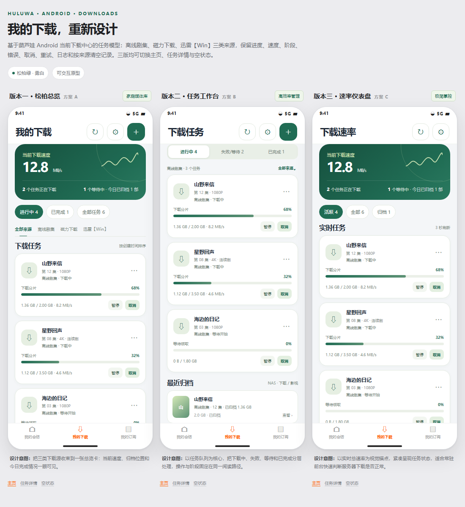

# 葫芦娃 Android · 我的下载三版重设计

本原型基于葫芦娃 Android 现有的 `DownloadsScreen.kt` 与 `DownloadTask` 数据模型重新设计，覆盖离线剧集、磁力下载、迅雷【Win】三类来源，以及进度、速度、阶段、错误、取消、重试、日志和按来源清理记录。

## 三个方案

1. **松柏总览**：以当前下载速度、等待/归档摘要为顶部总览，任务列表承载真实进度与动作，最接近现有产品的延续升级。
2. **任务工作台**：以进行中、失败/等待、已完成的分层任务队列为核心，适合频繁维护任务的 NAS 用户。
3. **速率仪表盘**：以实时总速率为视觉锚点，用紧凑任务列表快速判断服务器下载状态，适合常驻前台查看。

## 页面与交互

- 每版都有“主页 / 任务详情 / 空状态”三种可切换视图。
- 主页可切换任务筛选，任务卡提供暂停、取消、重试、打开等演示动作。
- 底部保持葫芦娃现有三标签：我的会话、我的下载、我的订阅。
- 视觉沿用现有松柏绿、雾白、柔和圆角卡片与图标体系，没有改动业务仓库。

## 预览

直接打开 `index.html` 可查看交互原型。

## 验证状态

已完成浏览器实际渲染、任务详情/空状态切换、筛选反馈检查。按要求未运行 Android 构建、编译、打包或安装。
