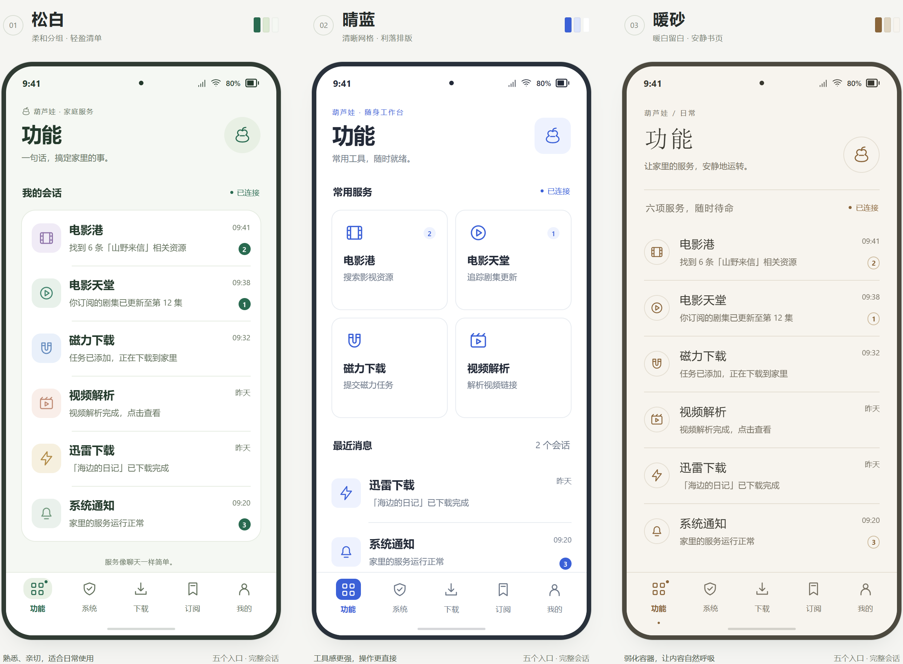

# 葫芦娃手机端 · 三种简约设计

本目录是基于当前葫芦娃原生 Android 源码制作的独立交互原型。三版保留“功能、系统、下载、订阅、我的”五个入口，另外覆盖会话详情、任务详情和空状态。

所有账号、服务器地址、任务、影视名称、封面与时间均为本地示例；原型不连接业务服务器，刷新页面可恢复初始状态。现有 Android 业务代码与已有未提交改动均未修改。

## 查看方式

直接用浏览器打开同目录的 `index.html` 即可，无需安装依赖，也不需要构建。

- 顶部页面标签可以同步切换三个方案，便于比较同一功能。
- 风格选项可以并排比较或单独查看；手机宽度下默认显示松白，可切换晴蓝、暖砂。
- 每台手机中的底部导航、服务入口、下载筛选、来源筛选、更多按钮、会话输入框均可体验。
- “查看空状态”切换示例空页面；演示任务及订阅操作只影响当前方案。

## 三个设计方向

| 方案 | 整体气质 | 布局区别 | 核心配色 |
| --- | --- | --- | --- |
| 松白 | 轻盈、亲切、延续现有品牌 | 柔和分组清单、圆角白卡片、浅绿选中态 | 松柏绿 `#296A50`、雾白 `#F5F8F3` |
| 晴蓝 | 明快、利落、操作直接 | 功能与系统使用工具网格，下载使用平铺队列，订阅使用双列封面 | 晴蓝 `#3B60D7`、纯白 `#FFFFFF` |
| 暖砂 | 安静、克制、留白充分 | 无外层卡片的清单、细分隔线、宋体标题、暖白书页 | 茶褐 `#8A653A`、暖白 `#F7F4EE` |

三版不仅改变颜色，也改变信息组织、容器形态、标题字体、选中方式与封面排版。

## 完整手机屏幕

三版均包含顶部时间、移动信号、无线网络、电量百分比、电池图标、中间挖孔、页面标题、内容区、底部导航和手势条。状态栏与页面使用同一底色，状态图标跟随各版文字色。时间固定为 9:41、电量固定为 80%，用于比较设计效果。

落地原生页面时，顶部图标由 Android 系统绘制；沿用透明状态栏与深色图标，并使用真实系统安全区处理状态栏、挖孔和手势区域，不应将原型中的固定示意高度直接写入业务布局。

## 与当前源码的对应

源码基准目录：`android/app/src/main/java/com/huluwa/android/`。

| 设计内容 | 现有源码 | 对齐内容 |
| --- | --- | --- |
| 五个主入口 | `ui/HuluwaRoot.kt`、`data/Models.kt` | 功能、系统、下载、订阅、我的 |
| 功能与系统 | `ui/SessionsScreen.kt` | 功能会话与本地管理会话分开；系统通知仍在功能页 |
| 下载 | `ui/DownloadsScreen.kt`、`data/Models.kt` | 离线剧集、磁力下载、迅雷【Win】；进度、速度、状态与详情 |
| 订阅 | `ui/SubscriptionsScreen.kt`、`data/Models.kt` | 电影天堂显示集数，电影港显示磁力资源数；追更、暂停、检查与删除 |
| 我的 | `ui/MineScreen.kt` | 账号与连接状态、连接配置、密码入口、退出与切换服务器 |
| 会话详情 | `ui/ChatScreen.kt` | 消息、影视结果、资源列表与订阅入口 |
| 品牌与视觉 | `ui/Theme.kt`、`ui/Components.kt` | 沿用葫芦娃的家庭服务定位，提供三种视觉方向 |

下载任务没有增加现有接口不支持的通用暂停操作；离线剧集演示取消、重试和日志，其他来源保留任务详情。电影港资源加入磁力任务，电影天堂资源加入离线剧集任务。

系统管理的二级弹层只示意信息层级，没有实现完整 Frp、Docker、构建或在线更新流程。

## 文件说明

| 文件 | 内容 |
| --- | --- |
| `index.html` | 方案对比、风格选择、页面选择与空状态开关 |
| `styles.css` | 三套主题、手机状态栏、内容布局、底部导航及响应式规则 |
| `app.js` | 本地数据与演示交互；无第三方库依赖、无网络请求 |
| `assets/gourd.svg` | 葫芦轮廓标识 |
| `assets/mountain.svg`、`assets/stars.svg`、`assets/journey.svg` | 本地矢量示意封面 |
| `preview-overview.png` | 功能页三版并排高清效果 |
| `preview-system.png`、`preview-downloads.png`、`preview-subscriptions.png`、`preview-mine.png`、`preview-chat.png` | 各页面三版并排效果 |
| `preview-empty.png`、`preview-details.png` | 空状态与详情弹层效果 |
| `preview-functions.png` | 完整设计对比页截图 |
| `phone-pine.png`、`phone-blue.png`、`phone-sand.png` | 三个独立手机屏幕 |
| `verification.json` | 浏览器检查记录 |

## 已完成验证

- 已实际渲染三版共十八个页面，检查高清截图、顶部状态栏、底部导航与详情弹层。
- 通过 59 项主要交互检查：导航、组合筛选、空状态、详情、取消与重试、链接校验、订阅管理、会话与键盘关闭弹层。
- 检查 375、390、768、1024、1440 五种宽度，共 90 个页面与风格组合，未发现内容横向溢出或状态栏越界。
- 已验证文件直接打开与本地素材加载，并单独检查两类订阅资源的计数与下载来源。
- 按要求未执行 Android 构建、编译、打包或安装，未做原生设备运行验证。

